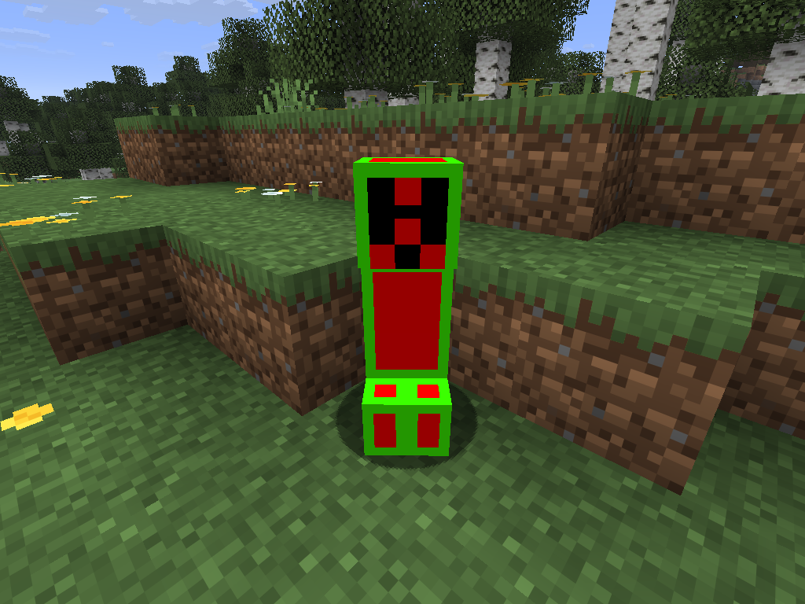
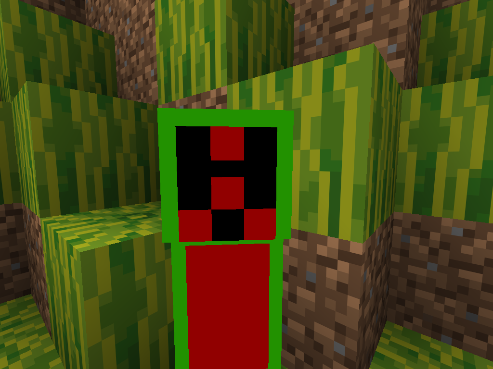
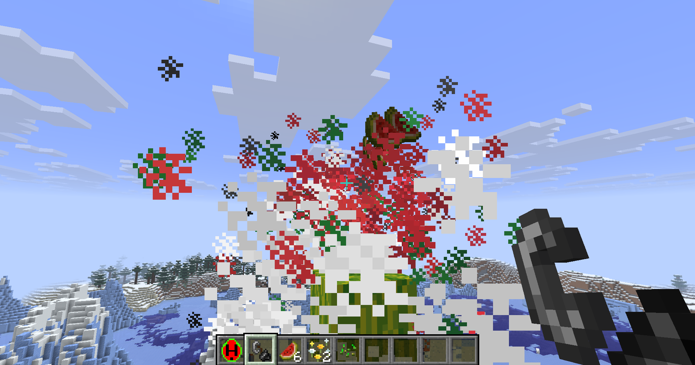
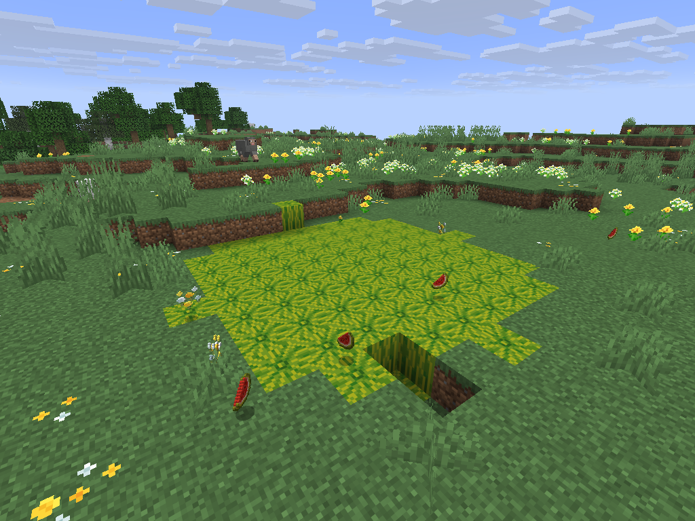
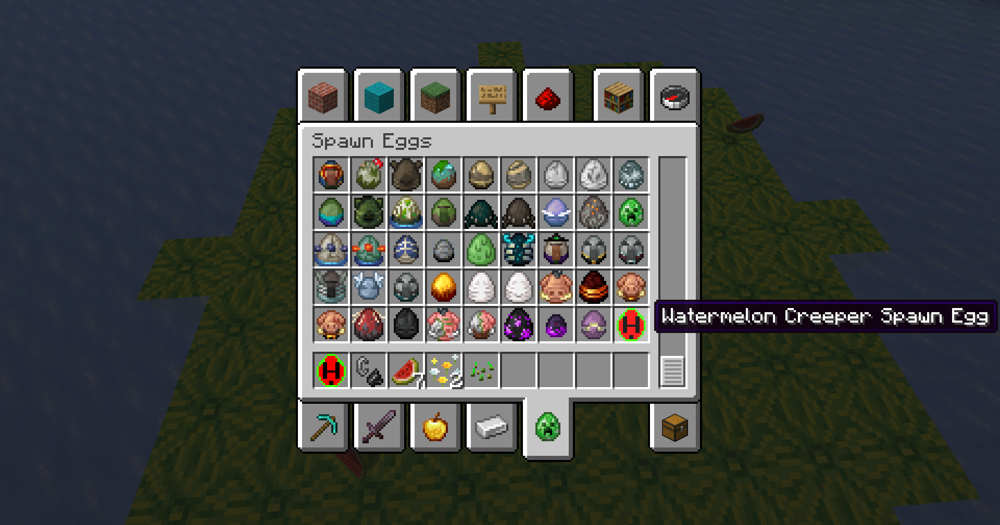
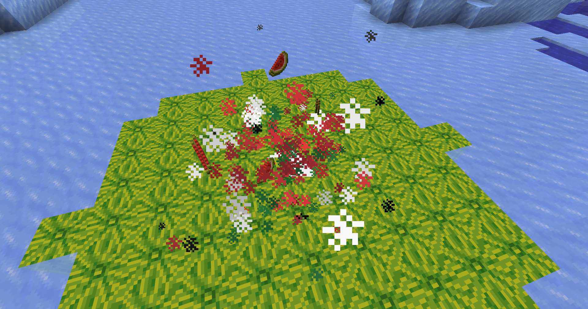

# Watermelon Creeper

*A Minecraft Java Edition mod created by my son and I.*

Watermelon Creeper adds a new, watermelon-themed Creeper variant to Minecraft. These unusual Creepers spawn across the overworld, pursue players, and explode into a shower of collectible melon slices!

Unlike ordinary Creepers, they don't leave craters. Instead, their explosions transform nearby surface blocks into watermelons.

## About This Project

Watermelon Creeper started as an idea from my son. He came up with the original concept and design for a Creeper that looks like a watermelon and explodes into watermelon slices.

We worked together to bring his idea into Minecraft as a playable mod.

We had fun building it together, and we're excited to share it.

## Features

- **Custom Creeper:** A Creeper with its own original texture.
- **Natural Spawning:** Rarely appears in overworld biomes.
- **Watermelon Explosion:** Bursts into collectible melon slices that scatter in different directions.
- **Colorful Particles:** Red and green particles accompany each explosion.
- **Terrain Transformation:** Converts nearby surface blocks into melon blocks within a five-block horizontal radius.
- **Custom Spawn Egg:** Spawn Watermelon Creepers manually using a dedicated spawn egg.
- **Non-Destructive Blast:** The explosion itself doesn't create craters, although the watermelon transformation changes terrain.

## Screenshots

## Requirements

| Component | Requirement |
|---|---|
| Minecraft | Java Edition 26.3 |
| Mod Loader | Fabric |
| Fabric Loader | 0.19.5 or compatible newer version |
| Dependency | Fabric API for Minecraft 26.3 |

Other Minecraft versions and mod loaders have not been tested.

## Installation

### Using CurseForge

1. Open the CurseForge application.
2. Create or select a Minecraft 26.3 profile using Fabric.
3. Install the compatible Fabric API.
4. Open the profile's `mods` folder.
5. Copy the Watermelon Creeper release JAR into that folder.
6. Launch Minecraft through CurseForge.

### Manual Installation

1. Install Fabric Loader for Minecraft 26.3.
2. Download and install the compatible Fabric API.
3. Download the Watermelon Creeper release JAR.
4. Place both mod JAR files in your Minecraft `mods` directory.
5. Launch Minecraft using the Fabric profile.

**Note:** Download the release JAR, not the source-code archive.

## Gameplay

### Finding Watermelon Creepers

Watermelon Creepers spawn naturally as uncommon hostile mobs in all biomes.

They follow normal hostile-mob spawning rules, so they're most likely to appear in sufficiently dark areas.

### Spawning Manually

In Creative Mode, find the **Watermelon Creeper Spawn Egg** in the Spawn Eggs inventory tab.

You can also obtain an egg with:

`/give @s watermelon-creeper:watermelon_creeper_spawn_egg`

Or summon the mob directly:

`/summon watermelon-creeper:watermelon_creeper ~ ~ ~`

### Explosion Behavior

When a Watermelon Creeper detonates:

1. Nearby entities receive explosion damage (less than vanilla Creeper).
2. Red and green particles burst outward.
3. Collectible melon slices fly through the air.
4. Nearby surface blocks within five blocks may transform into watermelon blocks.
5. The Watermelon Creeper disappears.

The explosion does not destroy terrain in the same manner as a normal Creeper.

### Important: Terrain Transformation

**Watermelon Creepers can permanently change the landscape!**

The terrain transformation affects exposed surface blocks, potentially including player-built blocks, within a five-block horizontal radius.

The transformation skips certain protected block types, including bedrock and blocks containing block entities.

To prevent Watermelon Creepers from transforming terrain, disable mob griefing:

`/gamerule mob_griefing false`

This also changes the behavior of other mobs affected by Minecraft's mob-griefing gamerule.

We recommend testing the mod in a new world or backing up existing worlds before installing it.

## Development

Watermelon Creeper is an open-source project developed using Java and the Fabric modding framework.

### Building from Source

Requirements:

- JDK 25
- Git
- A Java-compatible IDE such as Visual Studio Code

Clone the repository:

`git clone https://github.com/THume/watermelon-creeper-mod.git`

Navigate into the project and run:

**Windows:** `.\gradlew.bat build`

**macOS/Linux:** `./gradlew build`

The compiled mod JAR can be found in `build/libs/`.

To launch the development client, use the Gradle `runClient` task.

## Bug Reports and Contributions

Found a bug or have an idea for an improvement?

Please use [GitHub Issues](https://github.com/THume/watermelon-creeper-mod/issues) to report problems or suggest features.

Contributions and pull requests are welcome.

## Credits

**Original Concept and Design:** My son

**Development:** Me

This mod is a father-and-son project, and we're pleased to share it with the community.

## License

Watermelon Creeper is licensed under the **MIT License**.

See the [LICENSE](LICENSE) file for the full license text.

Minecraft is a trademark of Mojang Studios. This project is an independent fan-made modification and is not affiliated with or endorsed by Mojang Studios or Microsoft.